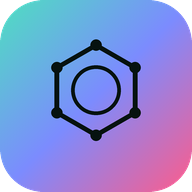
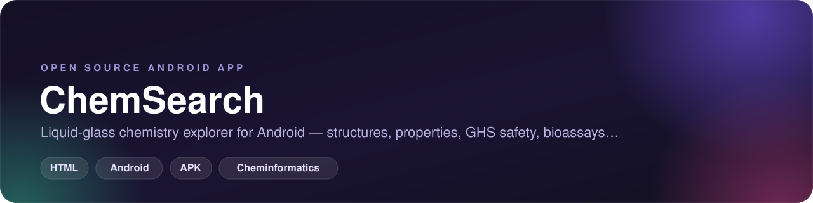

<div align="center">





<a href="https://github.com/technicalnihilist-lgtm/ChemSearch/stargazers"></a>&nbsp;<a href="https://github.com/technicalnihilist-lgtm/ChemSearch/network/members"></a>

<a href="https://github.com/technicalnihilist-lgtm/ChemSearch/releases/latest/download/ChemSearch-1.1.0.apk"></a> <a href="https://technicalnihilist-lgtm.github.io/apps-site/apps/ChemSearch.html"></a>

<b>Support the work</b>

  

<sub>Donations aren't live yet — Paytm, UPI, PayPal and Buy&nbsp;Me&nbsp;a&nbsp;Coffee all show <b>coming soon</b>. Until then, a ⭐ star is the best support.</sub>

<a href="https://github.com/technicalnihilist-lgtm/ChemSearch/releases/latest"></a>  <a href="https://github.com/technicalnihilist-lgtm/ChemSearch/releases"></a>

</div>

---

## Install

Download the signed APK from the [latest release](../../releases/latest) and open it on your phone
(Android 7.0 / API 24 or newer). The app needs an internet connection — every record is fetched from
PubChem at the moment you open it.

## What's inside

The **home screen is the hub**. Search sits at the top, and directly below it are six tiles
(data sections, search modes, periodic table, random compound, saved & history, PubChem credit)
followed by a full list of all 14 data sections with a one-line description of each. Tap any
section and it opens inside your last-viewed compound — so you can reach every corner of the app
without hunting through menus.

| Section | What you get |
| --- | --- |
| **Overview** | 2D structure, formula, weight, exact mass, XLogP3, HBD/HBA, rotatable bonds, TPSA, complexity, identifiers, synonyms, safety glance |
| **Properties** | Every computed descriptor PubChem publishes for the record, plus all depositor synonyms |
| **Structure** | Large 2D depiction, 3D conformer image, stereochemistry counts, SDF downloads |
| **Physical** | PubChem "Chemical and Physical Properties" — appearance, melting/boiling point, density, solubility, pKa, vapour pressure… |
| **Safety** | GHS pictograms, signal word, H-statements, toxicological, ecological and transport data |
| **Bioactivity** | Linked PubChem BioAssays (AIDs) and the BioAssay summary section |
| **Literature** | PubMed IDs and the full depositor literature record |
| **Patents** | Patent identifiers cross-referenced to Google Patents |
| **Classes** | MeSH tree, ChEBI, KEGG, ATC codes and the rest of the PubChem classification |
| **Spectra** | NMR, mass spec, IR, Raman and UV-Vis records from PUG View |
| **Uses** | Use & manufacturing, drug/medication information, agrochemical information |
| **Vendors** | Chemical vendors and supplier records |
| **Similar** | Fingerprint similarity search (fastsimilarity_2d, ≥ 90 %) |
| **Download** | PNG, SDF (2D/3D), JSON, XML and a ready-made citation |

Plus a full **periodic table** of the 118 elements with PubChem element properties, saved compounds,
search history and a light/dark liquid-glass theme.

## Data source and credit

All chemical data is retrieved from **PubChem**, an open chemistry database at the National Center for
Biotechnology Information (NCBI), U.S. National Library of Medicine, National Institutes of Health.

> Kim S, Chen J, Cheng T, Gindulyte A, He J, He S, Li Q, Shoemaker BA, Thiessen PA, Yu B, Zaslavsky L,
> Zhang J, Bolton EE. *PubChem 2025 update.* Nucleic Acids Research. 2025;53(D1):D1516–D1525.
> doi:[10.1093/nar/gkae1059](https://doi.org/10.1093/nar/gkae1059)

PubChem data is in the public domain. ChemSearch is an independent client — it is not endorsed by,
affiliated with, or supported by NCBI or NIH.

**Endpoints used**

```
https://pubchem.ncbi.nlm.nih.gov/rest/pug/compound/...            PUG REST
https://pubchem.ncbi.nlm.nih.gov/rest/pug_view/data/compound/...  PUG View
https://pubchem.ncbi.nlm.nih.gov/rest/autocomplete/compound/...   Autocomplete
https://pubchem.ncbi.nlm.nih.gov/rest/pug/periodictable/JSON      Periodic table
```

PubChem asks API clients to keep to **5 requests per second**; ChemSearch caches responses in memory
and fetches each section only when you open it.

## How it is built

* **`index.html`** — the entire app: markup, liquid-glass CSS and vanilla JavaScript in one file.
  No frameworks, no build step, no analytics, no accounts. Works in any modern browser, including
  desktop Chrome.
* **`android/`** — a thin native WebView shell (`MainActivity` + `AppWebViewClient`) that loads the
  bundled HTML from `assets/`. External links open in the system browser.
* **`android/build.sh`** — builds and signs the APK with the SDK command-line tools only
  (`aapt2` → `javac` → `d8` → `zipalign` → `apksigner`). No Gradle, no Android Studio.

### Build it yourself

```bash
export ANDROID_HOME=$HOME/Android/Sdk     # needs build-tools 34 + platform android-34
export JAVA_HOME=/path/to/jdk             # JDK 11 or newer
bash android/build.sh                     # -> android/ChemSearch-1.0.0.apk
```

The script creates its own signing keystore (`android/chemsearch.jks`) on first run. Replace it with
your own release key before publishing anywhere.

### Run the web app alone

```bash
python3 -m http.server 8080    # then open http://localhost:8080
```

## Screenshots

The screenshots above were rendered from the app at 430 × 932 (2× DPR) using a headless browser with a
local fixture, because the build machine could not reach `pubchem.ncbi.nlm.nih.gov`. On a device the
app draws the real PubChem structure images and GHS pictograms.

## Privacy

No tracking, no telemetry, no accounts. Favourites and history live in `localStorage` on the device.
Queries go only to `pubchem.ncbi.nlm.nih.gov`.

## Disclaimer

Data is provided as-is by PubChem and may be incomplete, depositor-supplied or out of date. Do not use
ChemSearch as the sole basis for medical, safety, legal or regulatory decisions.

## Licence

MIT — see [LICENSE](LICENSE). PubChem data remains subject to PubChem's own terms.

---

## 🌍 Languages

<sub>Donations are <b>coming soon</b> in every language below — nothing to pay today, nothing to click.</sub>

<div align="center">

<sub><b>हिन्दी · বাংলা · मराठी · తెలుగు · தமிழ் · ગુજરાતી · ಕನ್ನಡ · മലയാളം · ਪੰਜਾਬੀ · ଓଡ଼ିଆ · অসমীয়া · اردو</b></sub>

</div>

<details>
<summary><b>🌍 Open the same message in 53 languages</b></summary>

**🇮🇳 Indian languages**

- **हिन्दी** (Hindi) — ☕ जल्द ही आ रहा है। · ⭐ अगर आपको यह ऐप और हमारा काम पसंद है, तो कृपया रिपॉजिटरी को स्टार दें और हमें फॉलो करें।
- **বাংলা** (Bengali) — ☕ খুব শিগগিরই আসছে। · ⭐ যদি আপনার এই অ্যাপ এবং আমাদের কাজ ভালো লাগে, তবে অনুগ্রহ করে রিপোজিটরিটিকে একটি স্টার দিন এবং আমাদের ফলো করুন।
- **मराठी** (Marathi) — ☕ लवकरच येत आहे. · ⭐ जर तुम्हाला हे ॲप आणि आमचं काम आवडलं असेल, तर कृपया रिपॉझिटरीला स्टार द्या आणि आम्हाला फॉलो करा.
- **తెలుగు** (Telugu) — ☕ త్వరలో రాబోతోంది. · ⭐ మీకు ఈ యాప్, మా పని నచ్చితే, దయచేసి రిపోజిటరీకి ఒక స్టార్ ఇచ్చి మమ్మల్ని ఫాలో అవ్వండి.
- **தமிழ்** (Tamil) — ☕ விரைவில் வருகிறது. · ⭐ உங்களுக்கு இந்த ஆப்பும் எங்க வேலையும் பிடிச்சிருந்தா, தயவுசெஞ்சு இந்த ரெபாசிட்டரிக்கு ஒரு ஸ்டார்…
- **ગુજરાતી** (Gujarati) — ☕ ટૂંક સમયમાં આવી રહ્યું છે. · ⭐ જો તમને આ એપ અને અમારું કામ ગમતું હોય, તો પ્લીઝ રિપોઝિટરીને સ્ટાર આપો અને અમને ફોલો કરો.
- **ಕನ್ನಡ** (Kannada) — ☕ ಶೀಘ್ರದಲ್ಲೇ ಬರುತ್ತಿದೆ. · ⭐ ನಿಮಗೆ ಈ ಆ್ಯಪ್ ಮತ್ತು ನಮ್ಮ ಕೆಲಸ ಇಷ್ಟವಾದರೆ, ದಯವಿಟ್ಟು ರೆಪೊಸಿಟರಿಗೆ ಸ್ಟಾರ್ ಕೊಡಿ ಮತ್ತು ನಮ್ಮನ್ನು ಫಾಲೋ ಮಾಡಿ.
- **മലയാളം** (Malayalam) — ☕ ഉടൻ വരുന്നു. · ⭐ നിങ്ങൾക്ക് ഈ ആപ്പും ഞങ്ങളുടെ പ്രവർത്തനവും ഇഷ്ടപ്പെട്ടെങ്കിൽ, ദയവായി റെപ്പോസിറ്ററിക്ക് ഒരു സ്റ്റാർ…
- **ਪੰਜਾਬੀ** (Punjabi) — ☕ ਜਲਦੀ ਆ ਰਿਹਾ ਹੈ। · ⭐ ਜੇ ਤੁਹਾਨੂੰ ਇਹ ਐਪ ਅਤੇ ਸਾਡਾ ਕੰਮ ਪਸੰਦ ਹੈ, ਤਾਂ ਕਿਰਪਾ ਕਰਕੇ ਰਿਪੋਜ਼ਟਰੀ ਨੂੰ ਸਟਾਰ ਦਿਓ ਅਤੇ ਸਾਨੂੰ ਫਾਲੋ ਕਰੋ।
- **ଓଡ଼ିଆ** (Odia) — ☕ ଖୁବ୍ ଶୀଘ୍ର ଆସୁଛି। · ⭐ ଯଦି ଆପଣଙ୍କୁ ଏହି ଆପ୍ ଏବଂ ଆମର କାମ ଭଲ ଲାଗୁଛି, ତେବେ ଦୟାକରି ରିପୋଜିଟୋରୀକୁ ଗୋଟିଏ ଷ୍ଟାର୍ ଦିଅନ୍ତୁ ଏବଂ ଆମକୁ ଫଲୋ କରନ୍ତୁ।
- **অসমীয়া** (Assamese) — ☕ অতি সোনকালেই আহি আছে। · ⭐ যদি আপুনি এই এপটো আৰু আমাৰ কাম ভাল পায়, তেন্তে অনুগ্ৰহ কৰি ৰিপজিটৰীটোক এটা ষ্টাৰ দিয়ক আৰু আমাক ফ'ল' কৰক।
- **اردو** (Urdu) — ☕ جلد آرہا ہے۔ · ⭐ اگر آپ کو یہ ایپ اور ہمارا کام پسند آئے تو براہ کرم ریپازٹری کو سٹار دیں اور ہمیں فالو کریں۔
- **संस्कृतम्** (Sanskrit) — ☕ शीघ्रमेव आगच्छति।
- **मैथिली** (Maithili) — ☕ जल्दिये आबि रहल अछि।
- **कोंकणी** (Konkani) — ☕ रोखडेंच येता.
- **کٲشُر** (Kashmiri) — ☕ جَلدی یِوان چھُ۔
- **سنڌي** (Sindhi) — ☕ जल्द अची रह्यो आहे।
- **डोगरी** (Dogri) — ☕ जल्दी आ करदा ऐ।
- **ꯃꯤꯇꯩ ꯂꯣꯟ** (Manipuri) — ☕ ꯑꯊꯨꯕꯥ ꯃꯇꯝꯗꯥ ꯂꯥꯛꯀꯅꯤ꯫
- **बर’** (Bodo) — ☕ थाबैनो फैगोन।
- **ᱥᱟᱱᱛᱟᱲᱤ** (Santali) — ☕ ᱞᱚᱜᱚᱱ ᱦᱤᱡᱩᱜ ᱠᱟᱱᱟ᱾
- **नेपाली** (Nepali) — ☕ छिट्टै आउँदैछ। · ⭐ यदि तपाईंलाई यो एप र हाम्रो काम मन पर्‍यो भने, कृपया रिपोजिटरीलाई स्टार दिनुहोस् र हामीलाई फलो गर्नुहोस्।

**🌍 World languages**

- **العربية** (Arabic) — ☕ قريبًا. · ⭐ إذا أعجبك هذا التطبيق وعملنا، فيرجى منح المستودع نجمة ومتابعتنا.
- **简体中文** (Chinese (Simplified)) — ☕ 即将推出。
- **繁體中文** (Chinese (Traditional)) — ☕ 即將推出。
- **Čeština** (Czech) — ☕ Již brzy.
- **Dansk** (Danish) — ☕ Kommer snart.
- **Nederlands** (Dutch) — ☕ Binnenkort beschikbaar. · ⭐ Vind je deze app en ons werk leuk?
- **Filipino** (Filipino) — ☕ Malapit na.
- **Suomi** (Finnish) — ☕ Tulossa pian.
- **Français** (French) — ☕ Bientôt disponible. · ⭐ Si cette application et notre travail vous plaisent, mettez une étoile au dépôt et suivez-nous.
- **Deutsch** (German) — ☕ Bald verfügbar. · ⭐ Wenn dir diese App und unsere Arbeit gefallen, gib dem Repository einen Stern und folge uns.
- **Ελληνικά** (Greek) — ☕ Έρχεται σύντομα.
- **עברית** (Hebrew) — ☕ בקרוב.
- **Magyar** (Hungarian) — ☕ Hamarosan.
- **Bahasa Indonesia** (Indonesian) — ☕ Segera hadir. · ⭐ Jika kamu suka aplikasi ini dan karya kami, beri bintang pada repositori ini dan ikuti kami.
- **Italiano** (Italian) — ☕ In arrivo.
- **日本語** (Japanese) — ☕ 近日公開。 · ⭐ このアプリと私たちの仕事が気に入ったら、リポジトリにスターを付けてフォローしてください。
- **한국어** (Korean) — ☕ 곧 공개됩니다. · ⭐ 이 앱과 저희 작업이 마음에 드신다면 저장소에 스타를 눌러 주시고 팔로우해 주세요.
- **Bahasa Melayu** (Malay) — ☕ Akan datang.
- **Norsk** (Norwegian) — ☕ Kommer snart.
- **فارسی** (Persian) — ☕ به‌زودی.
- **Polski** (Polish) — ☕ Wkrótce. · ⭐ Jeśli podoba Ci się ta aplikacja i nasza praca, daj repozytorium gwiazdkę i obserwuj nas.
- **Português** (Portuguese) — ☕ Em breve.
- **Română** (Romanian) — ☕ În curând.
- **Русский** (Russian) — ☕ Скоро. · ⭐ Если вам нравится это приложение и наша работа, поставьте звёздочку репозиторию и подпишитесь на нас.
- **Español** (Spanish) — ☕ Muy pronto. · ⭐ Si te gusta esta app y nuestro trabajo, dale una estrella al repositorio y síguenos.
- **Kiswahili** (Swahili) — ☕ Inakuja hivi karibuni.
- **Svenska** (Swedish) — ☕ Kommer snart.
- **ไทย** (Thai) — ☕ เร็ว ๆ นี้
- **Türkçe** (Turkish) — ☕ Çok yakında.
- **Українська** (Ukrainian) — ☕ Незабаром.
- **Tiếng Việt** (Vietnamese) — ☕ Sắp ra mắt. · ⭐ Nếu bạn thích ứng dụng này và công việc của chúng tôi, hãy tặng kho lưu trữ một ngôi sao và theo…

</details>

