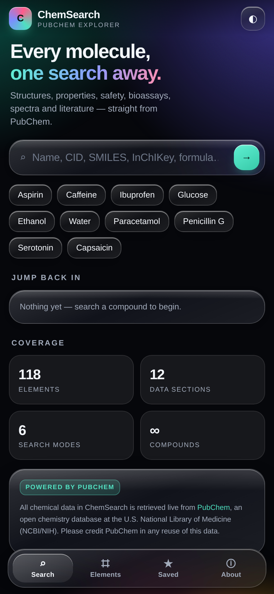
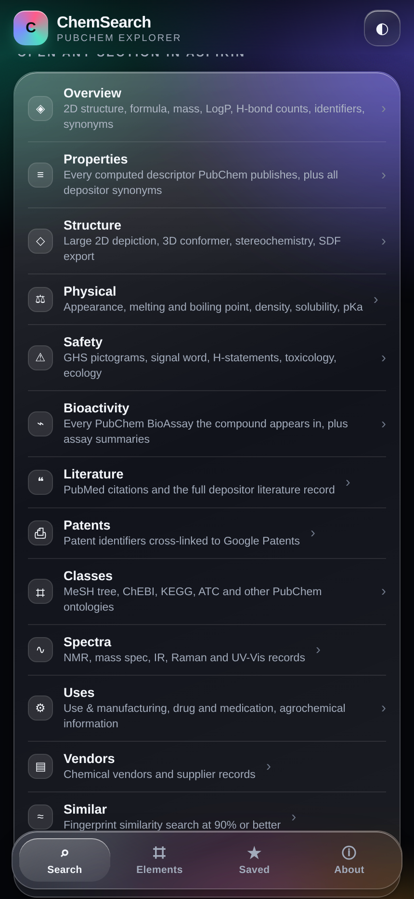
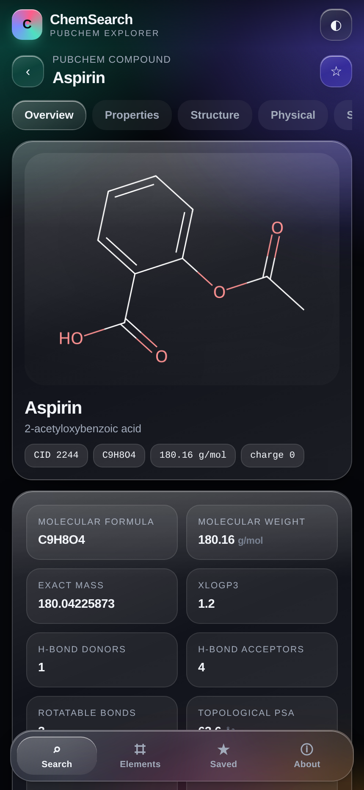
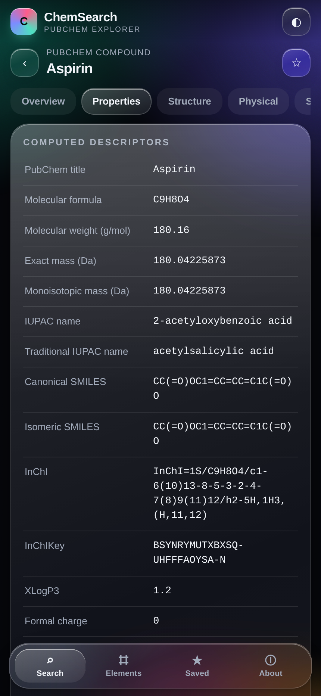
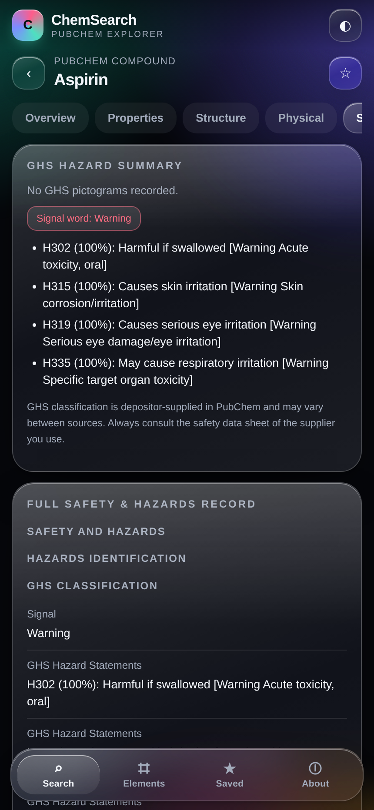
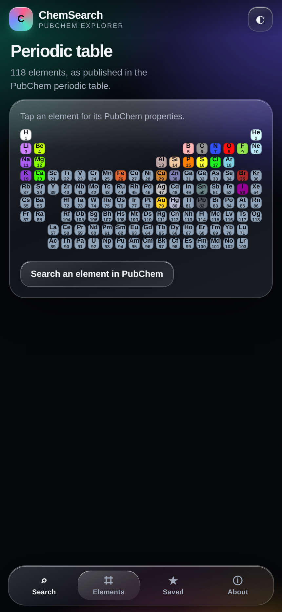
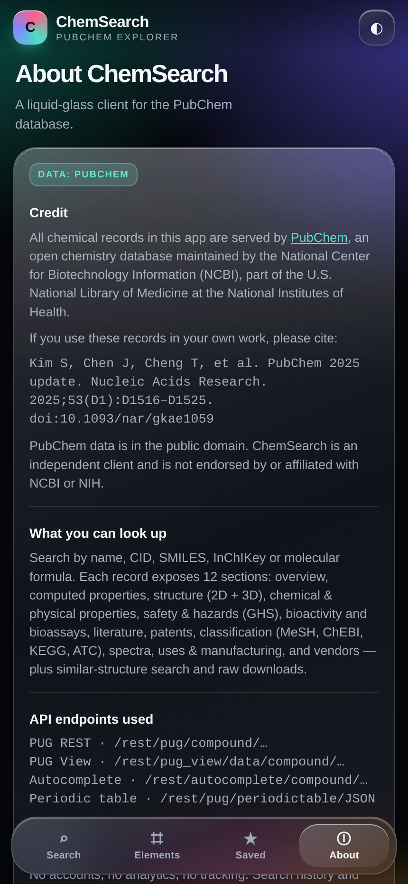

# ChemSearch

**A liquid-glass chemistry explorer for Android, powered entirely by [PubChem](https://pubchem.ncbi.nlm.nih.gov).**

Search any molecule by name, CID, SMILES, InChIKey or molecular formula and get structures, computed
descriptors, physical properties, GHS safety data, bioassays, literature, patents, classification,
spectra, uses, vendors and similar structures — all live from the PubChem PUG REST and PUG View APIs.

<p>
  
  
  
  
</p>
<p>
  
  
  
</p>

---

## Install

Download the signed APK from the [latest release](../../releases/latest) and open it on your phone
(Android 7.0 / API 24 or newer). The app needs an internet connection — every record is fetched from
PubChem at the moment you open it.

## What's inside

The **home screen is the hub**. Search sits at the top, and directly below it are six tiles
(data sections, search modes, periodic table, random compound, saved & history, PubChem credit)
followed by a full list of all 14 data sections with a one-line description of each. Tap any
section and it opens inside your last-viewed compound — so you can reach every corner of the app
without hunting through menus.

| Section | What you get |
| --- | --- |
| **Overview** | 2D structure, formula, weight, exact mass, XLogP3, HBD/HBA, rotatable bonds, TPSA, complexity, identifiers, synonyms, safety glance |
| **Properties** | Every computed descriptor PubChem publishes for the record, plus all depositor synonyms |
| **Structure** | Large 2D depiction, 3D conformer image, stereochemistry counts, SDF downloads |
| **Physical** | PubChem "Chemical and Physical Properties" — appearance, melting/boiling point, density, solubility, pKa, vapour pressure… |
| **Safety** | GHS pictograms, signal word, H-statements, toxicological, ecological and transport data |
| **Bioactivity** | Linked PubChem BioAssays (AIDs) and the BioAssay summary section |
| **Literature** | PubMed IDs and the full depositor literature record |
| **Patents** | Patent identifiers cross-referenced to Google Patents |
| **Classes** | MeSH tree, ChEBI, KEGG, ATC codes and the rest of the PubChem classification |
| **Spectra** | NMR, mass spec, IR, Raman and UV-Vis records from PUG View |
| **Uses** | Use & manufacturing, drug/medication information, agrochemical information |
| **Vendors** | Chemical vendors and supplier records |
| **Similar** | Fingerprint similarity search (fastsimilarity_2d, ≥ 90 %) |
| **Download** | PNG, SDF (2D/3D), JSON, XML and a ready-made citation |

Plus a full **periodic table** of the 118 elements with PubChem element properties, saved compounds,
search history and a light/dark liquid-glass theme.

## Data source and credit

All chemical data is retrieved from **PubChem**, an open chemistry database at the National Center for
Biotechnology Information (NCBI), U.S. National Library of Medicine, National Institutes of Health.

> Kim S, Chen J, Cheng T, Gindulyte A, He J, He S, Li Q, Shoemaker BA, Thiessen PA, Yu B, Zaslavsky L,
> Zhang J, Bolton EE. *PubChem 2025 update.* Nucleic Acids Research. 2025;53(D1):D1516–D1525.
> doi:[10.1093/nar/gkae1059](https://doi.org/10.1093/nar/gkae1059)

PubChem data is in the public domain. ChemSearch is an independent client — it is not endorsed by,
affiliated with, or supported by NCBI or NIH.

**Endpoints used**

```
https://pubchem.ncbi.nlm.nih.gov/rest/pug/compound/...            PUG REST
https://pubchem.ncbi.nlm.nih.gov/rest/pug_view/data/compound/...  PUG View
https://pubchem.ncbi.nlm.nih.gov/rest/autocomplete/compound/...   Autocomplete
https://pubchem.ncbi.nlm.nih.gov/rest/pug/periodictable/JSON      Periodic table
```

PubChem asks API clients to keep to **5 requests per second**; ChemSearch caches responses in memory
and fetches each section only when you open it.

## How it is built

* **`index.html`** — the entire app: markup, liquid-glass CSS and vanilla JavaScript in one file.
  No frameworks, no build step, no analytics, no accounts. Works in any modern browser, including
  desktop Chrome.
* **`android/`** — a thin native WebView shell (`MainActivity` + `AppWebViewClient`) that loads the
  bundled HTML from `assets/`. External links open in the system browser.
* **`android/build.sh`** — builds and signs the APK with the SDK command-line tools only
  (`aapt2` → `javac` → `d8` → `zipalign` → `apksigner`). No Gradle, no Android Studio.

### Build it yourself

```bash
export ANDROID_HOME=$HOME/Android/Sdk     # needs build-tools 34 + platform android-34
export JAVA_HOME=/path/to/jdk             # JDK 11 or newer
bash android/build.sh                     # -> android/ChemSearch-1.0.0.apk
```

The script creates its own signing keystore (`android/chemsearch.jks`) on first run. Replace it with
your own release key before publishing anywhere.

### Run the web app alone

```bash
python3 -m http.server 8080    # then open http://localhost:8080
```

## Screenshots

The screenshots above were rendered from the app at 430 × 932 (2× DPR) using a headless browser with a
local fixture, because the build machine could not reach `pubchem.ncbi.nlm.nih.gov`. On a device the
app draws the real PubChem structure images and GHS pictograms.

## Privacy

No tracking, no telemetry, no accounts. Favourites and history live in `localStorage` on the device.
Queries go only to `pubchem.ncbi.nlm.nih.gov`.

## Disclaimer

Data is provided as-is by PubChem and may be incomplete, depositor-supplied or out of date. Do not use
ChemSearch as the sole basis for medical, safety, legal or regulatory decisions.

## Licence

MIT — see [LICENSE](LICENSE). PubChem data remains subject to PubChem's own terms.
